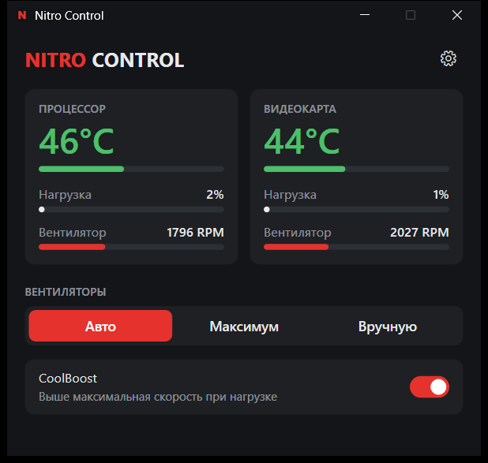
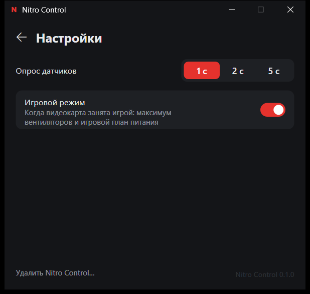

# Nitro Control

Быстрая и лёгкая замена Acer NitroSense для **Acer Nitro 5 AN515-44** (Ryzen 4000 + GTX 1650/1650 Ti).

*English: a tiny native replacement for Acer NitroSense on the Nitro 5 AN515-44. Fan modes (Auto / Max / Custom), CoolBoost, and a game mode that switches fans and power plan automatically. Opens in ~56 ms, uses ~6 MB of RAM in the background. The UI is in Russian.*

<p>
  
  
</p>

## Возможности

- **Мониторинг**: температура, загрузка CPU/GPU и обороты обоих вентиляторов.
- **Режимы вентиляторов**: «Авто» (управляет BIOS), «Максимум», «Вручную» (отдельно для CPU и GPU). Переключение мгновенное, без плавного затухания оборотов.
- **CoolBoost** для режима «Авто».
- **Игровой режим**. Когда видеокарта занята игрой (3D-нагрузка > 50 % дольше 10 с), программа включает максимум вентиляторов и свой план питания «Nitro Control — Игры». Через минуту после выхода из игры она возвращает «Авто» и тот план питания, который был до игры. Видео в браузере игровой режим не включает.
- **Кнопка NitroSense** на клавиатуре открывает Nitro Control.
- **Защита**: в ручном режиме при 90 °C на CPU или 85 °C на GPU временно включается максимум. Если служба падает или не может прочитать датчики, вентиляторы возвращаются под управление BIOS.
- Режимы сохраняются после перезагрузки и сна, автозапуск работает без запроса UAC.

## Сравнение с NitroSense

Замеры на AN515-44 скриптом `bench/bench.ps1` (память = Working Set − Private):

| | NitroSense 3.1 | Nitro Control |
|---|---|---|
| Окно появляется | ~500 мс | **~56 мс** |
| Окно готово | ~1.1 с | **~190 мс** |
| Память с открытым окном | 65 МБ | **~14 МБ** (служба + окно) |
| CPU с открытым окном | 4.9 % | **0.05 %** |
| Память в фоне | 4.9 МБ | ~6 МБ |
| Размер на диске | 33 МБ | **0.65 МБ** |

Окно рисуется через Direct2D на процессоре, поэтому открытое окно не будит дискретную видеокарту.

## Совместимость

- **Проверено**: Acer Nitro 5 AN515-44 (BIOS 1.04), Windows 11.
- **Может работать** на других Acer Nitro/Predator того же поколения с WMI-интерфейсом `AcerGamingFunction`, но номера вентиляторов и датчиков там могут отличаться. Сообщайте в Issues, если проверите.
- Если интерфейса нет, программа покажет «Этот ноутбук не поддерживается», ничего не изменит и не добавит себя в автозапуск.

## Установка

1. Скачайте `nitro-control.exe` из [Releases](../../releases) и положите в постоянную папку, например `C:\Program Files\Nitro Control\`.
2. Запустите и нажмите «Запустить службу». Windows один раз спросит права администратора: они нужны для доступа к BIOS. Служба сама добавит себя в автозапуск через Планировщик заданий, и больше UAC спрашивать не будет.
3. NitroSense лучше удалить: её служба тоже управляет вентиляторами и будет мешать.

Если перенести exe в другую папку, достаточно один раз запустить его оттуда: автозапуск обновится сам.

## Удаление

Откройте «Настройки» → «Удалить Nitro Control…» (или выполните `nitro-control.exe uninstall`). Программа уберёт автозапуск, игровой план питания и папку `%ProgramData%\NitroControl`, вернёт вентиляторы под управление BIOS и вернёт прежний план питания. После этого exe можно просто удалить.

## Что выяснили замеры

Пока делали программу, разобрались, на что вентиляторы этого ноутбука вообще влияют. Скрипты и сырые логи лежат в `bench/`.

- **Производительность упирается в лимиты мощности, а не в температуру.** GTX 1650 Ti держит свой предел ~48 Вт и не троттлит даже на 50 % оборотов (максимум 67 °C). Ryzen 5 4600H работает на 41–42 Вт, пока не исчерпан тепловой бюджет AMD (STAPM), а потом на 34 Вт.
- **Обороты влияют на CPU двумя способами.** На максимуме фаза 42 Вт держится ~5 минут вместо ~2 (+6 % частоты). При одновременной нагрузке CPU и GPU максимум не даёт процессору упереться в его потолок ~84 °C (+4 %). Поэтому игровой режим включает максимум.
- **Обороты сверх нужного почти не охлаждают.** Разница между 3500 и 4900 RPM всего около 2 °C.
- **В ручном режиме EC сам поднимает минимум оборотов по температуре видеокарты.** При ≥50 °C на GPU минимум ~3400/4100 RPM, при ≥60 °C ~3850/4600 RPM. Ниже ~35 % заданные проценты не действуют. Из-за этого собственная тихая кривая вентиляторов здесь не тише «Авто», и её из программы убрали.
- **CoolBoost не поднимает потолок оборотов в «Авто»**, но вдвое ускоряет их рост (45 с против 95 с), поэтому пик температуры на старте нагрузки ниже на ~4 °C.
- **Планы питания Windows лимиты мощности не меняют.** Для игр важна только парковка ядер: в игровом плане она выключена.
- **EC снижает обороты плавно** (~80–100 RPM/с), и обойти это можно только прямой записью в EC через драйвер ядра. Программа так не делает.

## Как это работает

Один exe в двух ролях:

- **`nitro-control.exe daemon`**: служба с правами администратора, запускается при входе через Планировщик заданий. Раз в 1–5 с опрашивает датчики через WMI (`root\WMI`), держит выбранный режим вентиляторов (переприменяет его после сна) и следит за перегревом. Окну она отвечает через именованный канал `\\.\pipe\nitro-control` (JSON, по строке на запрос). Настройки и лог лежат в `%ProgramData%\NitroControl`.
- **`nitro-control.exe`**: окно без прав администратора, нативный Win32 + Direct2D + DirectWrite.

Протокол BIOS, если пригодится для своих проектов:

| Действие | Вызов |
|---|---|
| Датчик | `AcerGamingFunction.GetGamingSysInfo(0x01 \| id << 8)`, значение `(out >> 8) & 0xFFFF`, младший байт = статус. id: 1 CPU °C, 2 вентилятор CPU, 6 вентилятор GPU, 0x0A GPU °C |
| Режим вентиляторов | `SetGamingFanBehavior(0x09 \| m << 16 \| m << 22)`, m: 1 авто, 2 максимум, 3 ручной |
| Скорость (ручной) | `SetGamingFanSpeed(fan \| pct << 8)`, fan: 1 CPU, 4 GPU |
| CoolBoost | `APGeAction.GetFunction(0x207)` (байт 1 = вкл), `SetFunction(7 \| on << 16)` |

64-битные аргументы WMI передаются строкой с десятичным числом, 32-битные числом (`VT_I4`).

## Сборка

Нужен [Rust](https://rustup.rs) 1.85+ (edition 2024):

```
cargo build --release
```

Результат: `target\release\nitro-control.exe`. Там же собирается `gpuload.exe`, генератор нагрузки на видеокарту для скриптов из `bench/`. Программе он не нужен.

## Отказ от ответственности

Программа не связана с Acer. Она управляет вентиляторами через штатный интерфейс BIOS, тот же, которым пользуется NitroSense, и не пишет напрямую в EC. Тем не менее используете на свой риск.

Лицензия: [MIT](LICENSE).
